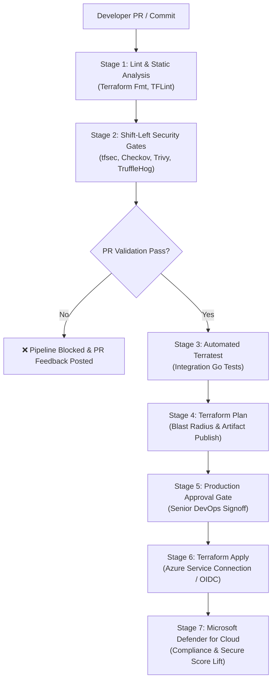

# 🛡️ Enterprise Azure DevSecOps Multi-Stage Pipeline

[](https://dev.azure.com)
[](https://github.com/gunjankumargaurav7350/azure-devsecops-pipeline)
[](https://trufflesecurity.com)
[](https://terratest.gruntwork.io/)

Production-grade, enterprise **Azure DevSecOps Delivery Pipeline** authored in **Azure DevOps YAML** and **GitHub Actions**. Designed and maintained by **Gunjan Kumar Gaurav** (Senior Cloud & DevSecOps Consultant).

> 🎯 **Key Impact Highlight:**  
> Integrated Shift-Left security gates directly into PR and Release workflows, successfully **reducing recurring production security findings by 30%** and elevating Microsoft Defender for Cloud secure compliance scores from **65% to 85%**.

---

## 🏛️ Architecture & Pipeline Flow



---

## 🚀 Quality Gates & Tools Integrated

| Quality Gate | Tool | Purpose | Enforcement Level |
|---|---|---|---|
| **Code Hygiene** | `terraform fmt`, `tflint` | Syntax correctness & Azure provider best practices | **Blocking** |
| **Secrets Detection** | `TruffleHog` | Scans git history & commits for leaked credentials/tokens | **Blocking** |
| **IaC Security** | `Checkov`, `tfsec` | CIS Azure Benchmark & NIST compliance rules | **Blocking on Critical/High** |
| **Vulnerability Audit** | `Trivy` | Checks cloud misconfigurations & dependency CVEs | **Blocking** |
| **Automated Testing** | `Terratest (Go)` | Deploys test ephemeral infra, validates outputs, destroys | **PR Gate** |
| **Blast Radius** | `Plan JSON Analyzer` | Reviews resource replacements before apply | **Human Review** |
| **Manual Gate** | `Azure DevOps Environment` | Strict 2-person approval rule for Production releases | **Mandatory Signoff** |

---

## 📂 Repository Directory Structure

```text
├── .github/
│   └── workflows/
│       └── devsecops-ci-cd.yml       # GitHub Actions equivalent workflow
├── azure-pipelines.yml               # Multi-stage Azure DevOps YAML pipeline
├── .checkov.yml                      # Checkov policy-as-code configuration
├── .tflint.hcl                       # TFLint Azure ruleset configuration
├── terraform/
│   ├── main.tf                       # Modular infrastructure provisioned with for_each
│   ├── variables.tf                  # Parameter definitions
│   ├── outputs.tf                    # Infrastructure outputs
│   └── versions.tf                   # HashiCorp Terraform & AzureRM provider
├── test/
│   ├── go.mod                        # Go module dependencies
│   └── pipeline_test.go              # Terratest integration testing suite
├── scripts/
│   └── run-security-gates.sh         # Local pre-commit security runner
└── README.md                         # Architecture and implementation guide
```

---

## 💻 Local Testing & Pre-Commit Execution

To execute the entire security gate suite locally before pushing:

```bash
chmod +x scripts/run-security-gates.sh
./scripts/run-security-gates.sh
```

To execute the automated Go Terratest suite:

```bash
cd test
go test -v -timeout 30m
```

---

## 👤 Author
**Gunjan Kumar Gaurav**  
*Senior Cloud & DevSecOps Consultant*  
[LinkedIn Profile](https://linkedin.com/in/gunjan-gaurav) • [GitHub](https://github.com/gunjankumargaurav7350)
